# Mesh Audio Editor

Real-time mesh viewer and editor that converts meshes to rigid-body audio models using linear modal analysis and synthesis.

[Renders](https://karlhiner.com/MeshEditor/render)


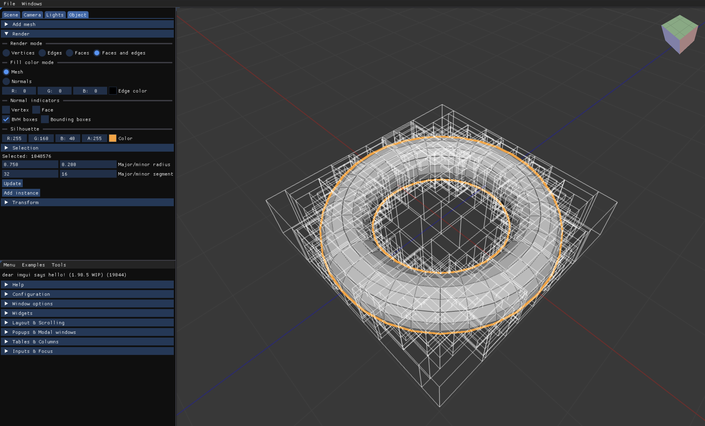
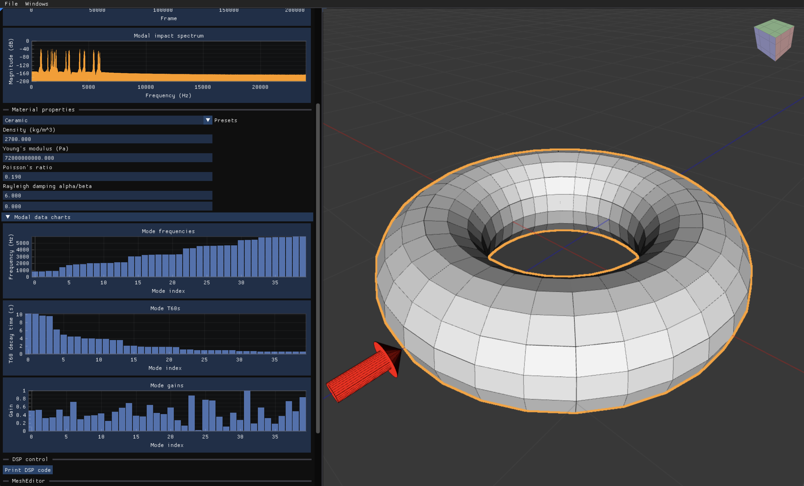
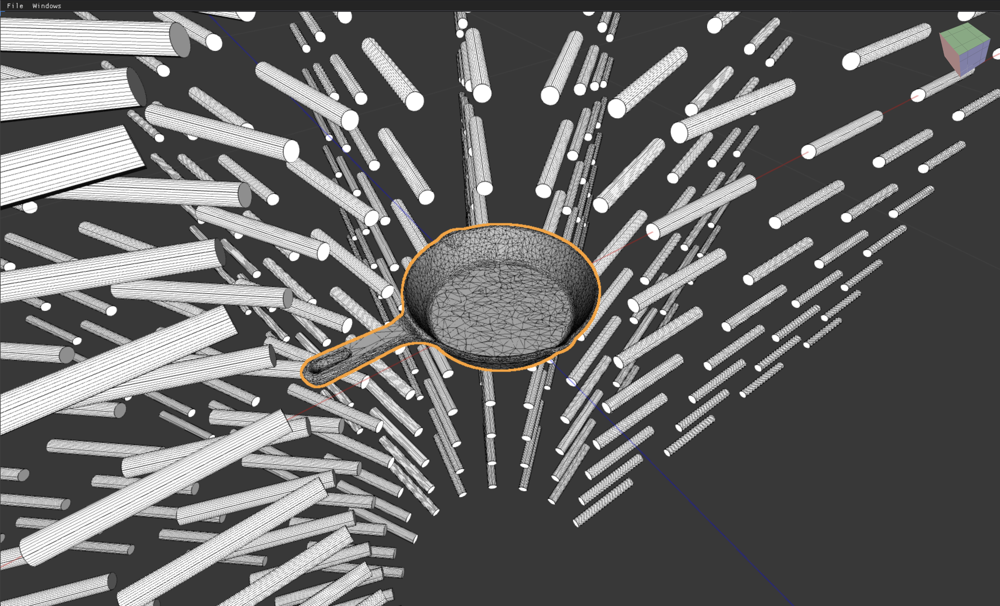
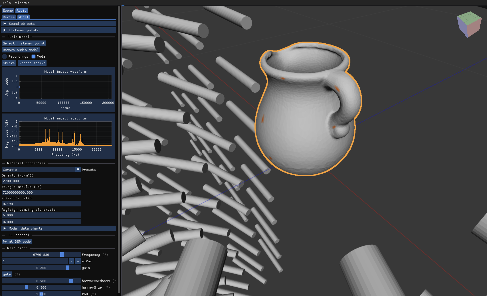
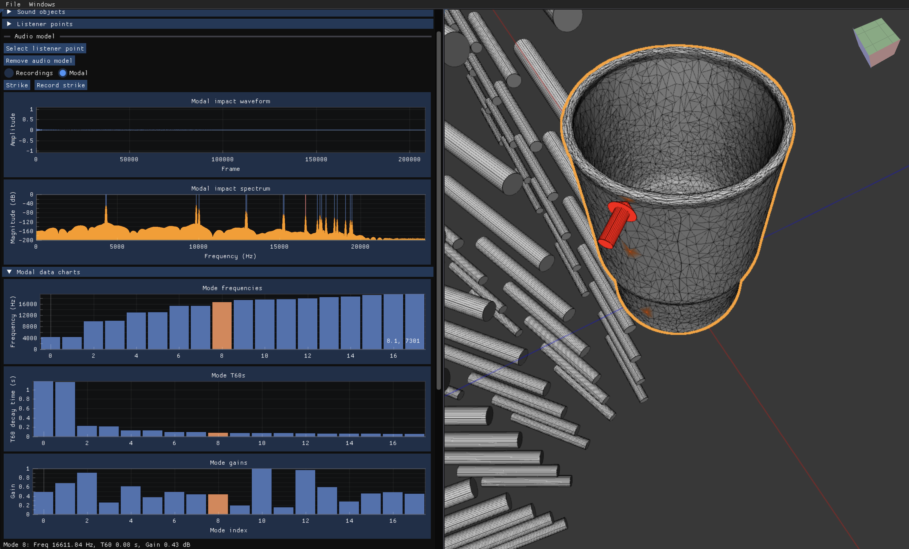

## Features

### General

* Branching undo/redo and navigation to any recorded state through the History window
* Save history and imported source assets in portable projects
* Create and delete meshes and mesh instances
  - Every mesh is a node graph whose cook is its geometry, edited in the Nodes tab
  - Primitives (Rect, Circle, Cube, IcoSphere, UVSphere, Torus, Cylinder, Cone) are generator nodes with editable parameters
  - Viewport operators append nodes after the displayed node, and any node's result can be displayed
  - Load `.obj` and `.ply` mesh files (via [tinyobjloader](https://github.com/tinyobjloader/tinyobjloader) and [tinyply](https://github.com/ddiakopoulos/tinyply))
* Select meshes, vertices, edges, or faces by clicking or box selection, through geometry with Blender's X-ray toggle (Alt+Z)
* Blender-style edit-mode topology operators on the GPU
  - Delete (X), dissolve (Ctrl+X), merge (M), extrude (E), duplicate (Shift+D), split (Y), and separate (P)
  - Fill (F), triangulate (Ctrl+T), tris to quads (Alt+J), loop cut (Ctrl+R), and rip (V)
  - Mouse-sized inset (I), bevel edges (Ctrl+B) and vertices (Ctrl+Shift+B) with wheel or -/= segments, and knife cuts (K)
  - Right-click, Ctrl+V, Ctrl+E, and Ctrl+F menus list additional operators.
    These include subdivide, poke, edge split, rotate edge, bridge edge loops, grid fill, fill holes, and solidify.
    They also include connect vertex path, flip normals, spin, extrude repeat, bisect, symmetrize, convex hull, and cleanup dissolves.
  - Edit any node's action parameters in the History window, with live previews and commits at that node
  - Extrude, duplicate, and rip commit with their placement drag as one history node, and cancelling the drag cancels the operator
  - Unported operators: wire edges (extruding lone vertices and ripping edges without faces), un-subdivide, decimate, wireframe, boolean, and intersect.
    Merges retain doubled faces, and grid fill spans one loop.
* Flat/smooth/wireframe mesh rendering
* Translate, rotate, and nonuniformly scale meshes and instances with numeric inputs or a Blender-style transform gizmo
* Edit the camera with the mouse wheel, numeric inputs, or a Blender-style orientation gizmo
* Edit cameras and scene lighting
* Render face/vertex normals as lines for debugging
* Render bounding box wireframes for debugging
* Depth-aware silhouette outlines for active meshes and instances
* Infinite grid with horizon fade

### Audio

* Enable/disable audio output and change device and native format/sample rate
* Volume / Mute
* Generate a physical audio model for any mesh; see [Physical audio modeling](#physical-audio-modeling)
  - Click on an audio mesh to excite the nearest vertex, or trigger a selected vertex in the audio menu
  - Strike any number of objects and vertices concurrently (polyphonic modal synthesis)
  - Edit synthesis parameters (gain, fundamental frequency, decay scale, click level) in real-time
* Load [RealImpact](https://samuelpclarke.com/realimpact/) object meshes and microphone positions

### Rendering and architecture

* Native Metal rendering through [metal-cpp](https://developer.apple.com/metal/cpp/).
  The last Vulkan commit was `dae664bd0f2bbdfcf309ba7d000ce9890edbcb38`.
* Bindless Tier-2 argument-buffer access and GPU-address vertex pulling from contiguous mesh-data arenas.
  Arenas store vertices, indices, attributes, selection state, and other mesh data.
* Batched indirect indexed draws with GPU-written instance counts and visibility remaps
* Directly mapped CPU/GPU storage on unified-memory Apple Silicon
* GPU-accelerated mouse interactions
* Half-edge iterators for mesh topology operations
* Shader hot reloading: edit and recompile MSL at runtime from the UI
* Matching C++/MSL structs and function-constant indices generated from YAML

## Physical audio modeling

MeshEditor generates physical audio models from meshes using linear modal analysis and synthesis.
The original implementation was a Georgia Tech PHYS-6260 Computational Physics project.
The [final report](paper/PAMofPassiveRigidBodies.pdf) and poster below document it.

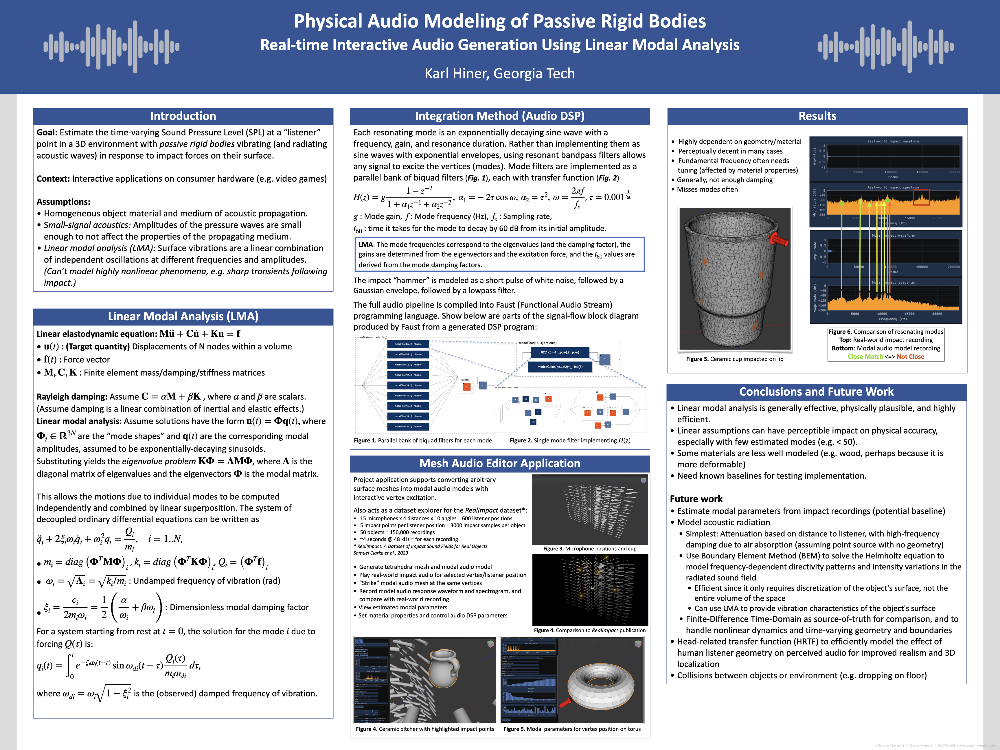

The report and poster describe a previous [Faust](https://github.com/grame-cncm/faust) synthesis path.
The current modal resonator bank supports concurrent sounding objects and physics collision impacts.
The last commit using Faust code generation is [31a817dd](https://github.com/khiner/MeshEditor/commit/31a817ddf1fd28d1b7aa1724e3e166b9c0eb58e4).

#### Impact audio experiments

These examples compare synthesized modal impacts with [RealImpact](https://samuelpclarke.com/realimpact/) recordings and scanned meshes.
Each synthesized impact injects a short wideband pulse at the selected vertex.
See [the blog post](https://karlhiner.com/mesh_audio_editor) for embedded audio players.

_The cylinders mark recorded microphone positions.
All recordings use a single microphone centered near the impacted object.
The modal audio samples represent estimated surface vibrations, as if recorded from a contact microphone, without acoustic radiation modeling._

| Object Name | Mesh | Real Impact Audio | Modal Impact Audio |
|-|-|-|-|
| Ceramic Koi Bowl | 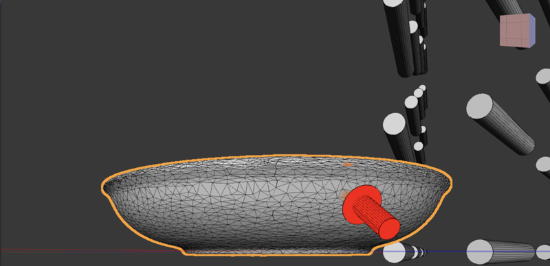 | [Impact](audio_samples/CeramicKoiBowlImpact.wav) | [Modal](audio_samples/CeramicKoiBowlModal.wav) |
| Ceramic Pitcher | 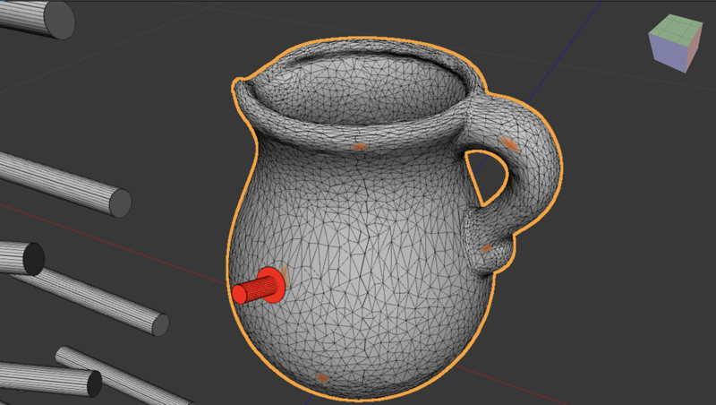 | [Impact](audio_samples/PitcherCeramicImpact.wav) | [Modal](audio_samples/PitcherCeramicModal.wav) |
| Glass Cup | 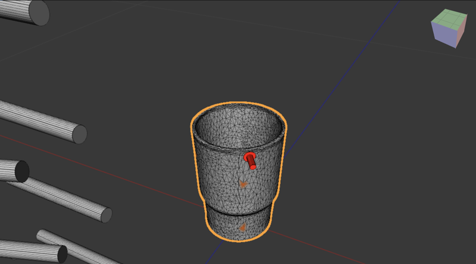 | [Impact](audio_samples/CupImpact.wav) | [Modal](audio_samples/CupModal.wav) |
| Iron Mortar | 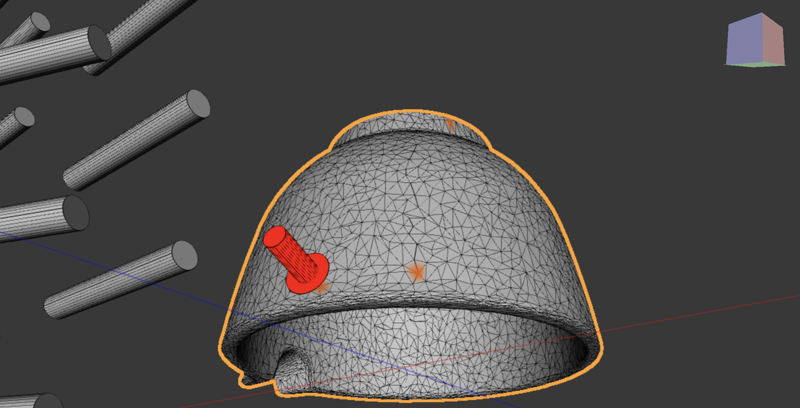 | [Impact](audio_samples/IronMortarImpact.wav) | [Modal](audio_samples/IronMortarModal.wav) |
| Iron Skillet | 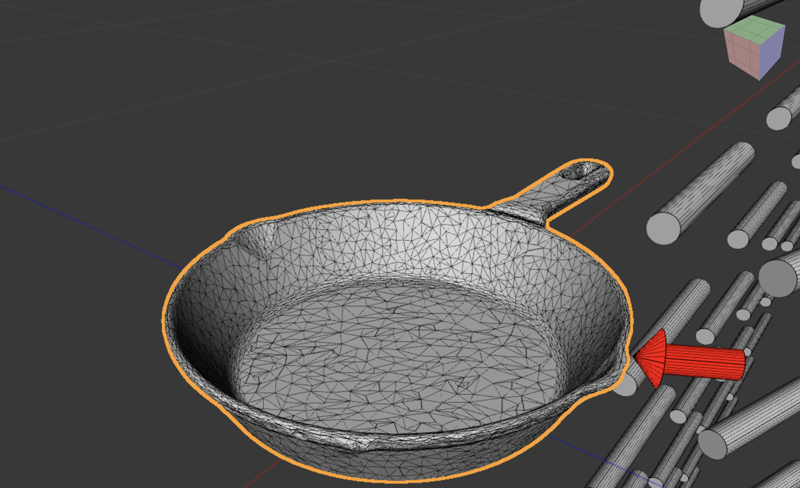 | [Impact](audio_samples/IronSkilletImpact.wav) | [Modal](audio_samples/IronSkilletModal.wav) |
| Plastic Scoop | 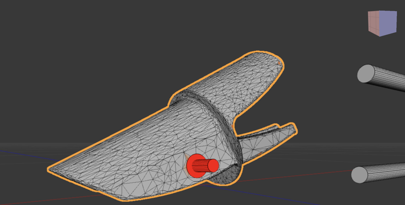 | [Impact](audio_samples/PlasticScoopImpact.wav) | [Modal](audio_samples/PlasticScoopModal.wav) |
| Small Swan Ceramic | 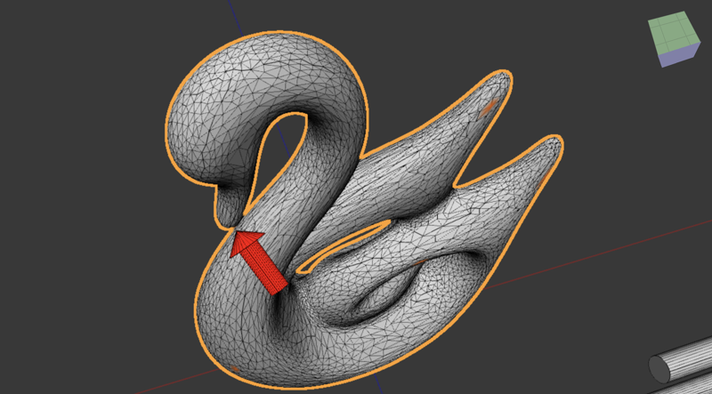 | [Impact](audio_samples/SmallSwanCeramicImpact.wav) | [Modal](audio_samples/SmallSwanCeramicModal.wav) |

## glTF viewer

MeshEditor is a glTF 2.0 viewer, editor, and exporter.
glTF scene nodes map to MeshEditor meshes, armatures, cameras, lights, and empty objects.
Scene parenting preserves the glTF node hierarchy.
Khronos-ratified extensions that affect scene appearance are imported, rendered, and editable.
Load and save preserve glTF data except for cases listed in `tests/RoundtripTest.cpp`.
PBR BRDF and lighting equations come directly from the reference [glTF-Sample-Renderer shaders](https://github.com/KhronosGroup/glTF-Sample-Renderer/blob/main/source/Renderer/shaders/).

Metal function constants specialize PBR variants for the current materials, lights, and image-based lighting.
Feature-mask changes rebuild affected pipeline states from cached MSL libraries.

#### glTF supported extensions

✅ supported | 🟨 partial | ⬜ not supported

| Extension | Status | Notes |
| - | - | - |
| `KHR_mesh_quantization` | ✅ | Handled in fastgltf parser/import path |
| `EXT_mesh_gpu_instancing` | ✅ | Imported into MeshEditor instances |
| `KHR_lights_punctual` | ✅ | Imported into MeshEditor light entities |
| `KHR_texture_transform` | ✅ | |
| `KHR_texture_basisu` | ✅ | Transcode KTX2 via [basis_universal](https://github.com/BinomialLLC/basis_universal); BC7/ETC2/RGBA32 selected by device support |
| `EXT_texture_webp` | ✅ | Decode via [libwebp](https://github.com/webmproject/libwebp); re-encode edited textures to lossless WebP on export |
| `KHR_materials_emissive_strength` | ✅ | |
| `KHR_materials_unlit` | ✅ | |
| `KHR_materials_specular` | ✅ | |
| `KHR_materials_sheen` | ✅ | |
| `KHR_materials_ior` | ✅ | |
| `KHR_materials_dispersion` | ✅ | |
| `KHR_materials_transmission` | ✅ | "Real transmission" toggle in Viewport Shading: on samples a pre-rendered scene texture; off samples the IBL. |
| `KHR_materials_diffuse_transmission` | ✅ | |
| `KHR_materials_volume` | ✅ | |
| `KHR_materials_clearcoat` | ✅ | |
| `KHR_materials_anisotropy` | ✅ | |
| `KHR_materials_iridescence` | ✅ | |
| `KHR_materials_variants` | ✅ | |
| `KHR_physics_rigid_bodies` | ✅ | (not yet ratified) |
| `KHR_implicit_shapes` | 🟨 | (not yet ratified) WIP |
| `KHR_node_visibility` | ✅ | Conformant load and roundtrip; see the visibility limitation below |
| `KHR_animation_pointer` | ✅ | Every mutable Object Model property of the supported extensions. |
| `EXT_lights_image_based` | ✅ | Imported as Scene IBL when present |
| `EXT_meshopt_compression` | ✅ | Decode compressed bufferViews via [meshoptimizer](https://github.com/zeux/meshoptimizer); export uncompressed geometry |

Hiding a parent while leaving its descendants visible is dropped on export because glTF cannot represent that visibility state.

## Build & run

See [production libraries](cmake/README.md) for source ownership, dependencies and optimization settings.

### Install dependencies

Requires Apple Silicon and the Xcode command-line tools.

```shell
$ git clone --recursive git@github.com:khiner/MeshEditor.git
$ brew install cmake llvm
$ brew link llvm --force
```

### Clone, clean, build, and run

```shell
$ git clone --recurse-submodules git@github.com:khiner/MeshEditor.git
$ cd MeshEditor
$ ./script/Clean # optionally clean first
$ ./script/Build [--release]
$ cd build && ./MeshEditor [file|--empty] [options]
```

* Open a project directory at its last saved position and layout, retaining the full working history, including edits made after Save.
  First Save and Save As choose a project name and location, and confirm replacement of an existing project.
  Project directories keep `working/` beside the compressed `Saved.project` archive.
  Later saves replace the archive, and Revert to Saved returns to its position and layout without removing history.
  Save As copies named projects and relocates unnamed projects.
  Unnamed interactive projects remain available under File → Restore, while headless jobs use temporary working directories.
  Clear history retains the current and last saved states as new replay baselines.
* Open `.gltf`, `.glb`, `.obj`, `.ply`, `.project`, or `.actions` files.
  `.project` extracts saved history into an unnamed working project.
  `.actions` contains the history tree and the assets loaded by its actions.
  Opening it replays every recorded action from the empty scene and fails on divergence.
  Omit `file` to load the default scene.
* `--empty` starts with an empty scene instead of the default scene.

`--play`, `--record`, and `--screenshot` use material preview shading with hidden overlays.
`--play` and `--record` run animation and physics; `--screenshot` captures the first frame.

* `--play [seconds]` starts playback.
  Optional `[seconds]` exits after the given duration.
  See `--record` below for how the duration is interpreted.
* `--record path.mp4` runs playback and writes the viewport as an H.264 `.mp4` via an `ffmpeg` subprocess (must be on `PATH`).
  A `.wav` path records the master audio output alone, and `--record-audio` muxes it into the video.
  With an active look-through camera, recording captures the camera-frame rectangle inside the dimmed overlay.
  Otherwise the full viewport is recorded.
* Motion blur uses fast velocity reconstruction by default.
  Choose **Full sampling** in the viewport controls or `--motion-blur N` (1–64) to average complete shutter renders.
  This captures changing visibility, reflections, and lighting.
  `--motion-blur fast` selects the default method.
  Both methods share the shutter setting and keep editor overlays sharp.
* `--fps N` sets the recording framerate (default 60).
* `--screenshot path.webp` writes a single image.
  The format is chosen by extension (`.webp` lossless, `.png`, `.jpg`/`.jpeg`), which is optional and defaults to `.webp`.
  The captured region matches `--record`.
  On its own, it exits after writing; combined with `--play [seconds]` or `--record`, it captures the frame and continues running.
* `--render basename` writes the scene's corpus artifacts under `basename.*` (used by `./script/Render` — see [Render corpus](#render-corpus)).
* `--render-queue dir` renders one scene per `dir/*.job` file in a single headless process.
  Each job contains an output basename followed by one command-line argument per line.
  Parallel workers can safely share one queue.
  `./script/Render` uses this option; capture settings match direct launches.
* `--headless` runs without a window and renders offscreen at 1280x800 with 2x pixel density.
  Capture flags read back this fixed viewport.
  Without a capture flag it renders one frame and exits, and a duration-less `--play` exits after one timeline loop.
  With `MESHEDITOR_VALIDATE_ACTIONS` enabled, replay and snapshot validation also compare the complete UI rendered offscreen.
* `--timeline-end seconds` sets the timeline's end so a long play runs without looping.
* `--frames N` renders N frames and exits.

View setup, applied after the scene loads:

* `--camera name` frames the named camera.
* `--shading wireframe|solid|preview|rendered` sets the viewport shading mode, and `--xray` turns on X-ray for it.
* `--overlays` draws the editor overlays, which the capture flags otherwise hide.
* `--display list` turns on display options by comma-separated name: `vertex-normals`, `face-normals`, `bounds`, `tet-wireframe`.
* `--edit vertex|edge|face` enters edit mode on the selected meshes, and `--select-all` selects all objects, or all elements in edit mode.
* `--lod-error pixels` sets the screen-space error budget of the cluster LOD cut.

Profiling, used by `script/Bench`:

* `--profile` prints the profile report on exit, and `--profile-json path` writes it to a file.
* `--bench-action steady|orbit|transform|visibility|box-select|box-select-orbit|pick-cycle` runs the named interaction every frame.
  `--bench-action-count N` limits transform and visibility actions to N objects (default 64).

The flags can be combined freely, except `--render` excludes `--record` and `--screenshot` (it derives its own outputs).
`--render --play N` caps the video at N seconds.

**Timing**: interactive simulation follows wall time.
Recording samples the viewport at `fps`, so the file plays at the same rate as the in-app preview.
`--play N` exits after N seconds — wall-clock when interactive, video-seconds when recording.
Headless runs and `--render` use a fixed timestep and advance as fast as the GPU permits.
They capture every tick at one timeline frame per tick, producing deterministic output independently of `--fps`.

### Render corpus

`render/` contains committed demo output for every scene in the corpus and mirrors the source layout.
It covers the built-in scenes, `res/examples/`, root audio samples, and glTF samples under `external/`.
Isolation audio samples under `samples/test/` use `script/AudioCorpus`; redundant glTF format variants are skipped.
Each scene directory contains rendered output, an `.actions` replay archive, a console `.log`, and a `run.sh` launcher.
Static scenes use lossless `.webp` files, including one per material variant.
Animated scenes use `.mp4` files with one timeline loop per animation clip.
A scene with sound objects renders its audio and muxes it into the `.mp4`.

Binary artifacts are stored in [git-lfs](https://git-lfs.com); fetch them after cloning:

```shell
$ git lfs install
$ git lfs pull
```

Regenerate the corpus with `./script/Render`.
`render/Benchmarks/Overlays/` adds fixed editor captures using the [overlay benchmark scene and cases](res/benchmarks/Overlays/benchmark.json).
Run `script/Render --overlays-only` to update just these captures (`--no-build` uses the existing executable).
These directories contain a lossless `.webp` and a `run.sh` that reproduces the capture headlessly; console logs stay local.
Overlay cases share the corpus queue, worker pool, and retry handling.

| Overlay cases | Coverage |
|-|-|
| `axes` | Grid/axis lines in front of and behind geometry-attached outlines |
| `overview`, `orthographic` | Linked/mirrored meshes, normals, bounds, lines, points, camera/light helpers, animated bones and bone X-ray |
| `edit-vertex`, `edit-edge`, `edit-face`, `edit-xray` | GPU box selection and orbit to reveal selected/unselected elements, with and without X-ray |
| `pick-1` through `pick-4` | Successive picks through overlapping opaque, mirrored and blended objects, a masked hole, and cycle wraparound |

The dense `overview` and `orthographic` cases use perspective and orthographic views, respectively.

Scenes render headless (no window or display needed) and in parallel (`JOBS` sets the worker count, default 8).
Rendering requires the glTF submodules and `ffmpeg` on `PATH` for videos.
Rendering uses one tick per timeline frame at a fixed extent and advances as fast as the GPU permits.
Artifacts are deterministic: after regeneration, `git status` shows only scenes whose rendering changed.

#### Fidelity gate

Use `git status` to check changes that require identical pixels.
Measure changes that permit bounded pixel differences, such as cluster LOD with a screen-space error limit:

```shell
$ ./script/RenderFidelity --app-args "FLAGS"
```

This command renders the whole corpus into `render_candidates/` with `FLAGS` passed to every worker, preserving the committed `render/` tree.
It reports each scene's changed-pixel share, largest and 99th-percentile per-channel differences, and mean difference.
It exits nonzero when a scene exceeds its budget in [`script/render_budgets.json`](script/render_budgets.json).
The default budget requires exact pixels; each per-scene exception records its measurement and reason.

`./script/CompareRenders <candidate-tree> [reference-tree]` runs the same comparison over any two render trees, writing the full report as JSON with `--json`.
Omit the reference tree to compare against the corpus committed at `HEAD`, read directly through Git.
Compare decoded video frames and audio to measure occasional one-LSB driver differences at the pixel level.
Sample 16 evenly spaced frames per video by default, or use `--video-frames 0` for every frame.

## Stack

- [Metal](https://developer.apple.com/metal/) via [metal-cpp](https://developer.apple.com/metal/cpp/) + [AppKit](https://developer.apple.com/documentation/appkit) + [ImGui](https://github.com/ocornut/imgui): Graphics + immediate-mode UI/UX
- Apple SIMD: Numeric vector/matrix types + math
- macOS Core Audio: HAL output and native audio-file I/O
- [FastFEM](https://github.com/khiner/FastFEM): Tetrahedralization, finite-element assembly, and modal eigensolves
- [fastgltf](https://github.com/spnda/fastgltf) glTF 2.0 scene loading
- [RigidBodyPhysics](https://github.com/khiner/RigidBodyPhysics): Rigid body physics
- [basis_universal](https://github.com/BinomialLLC/basis_universal) KTX2 texture transcoding (`KHR_texture_basisu`)
- [libwebp](https://github.com/webmproject/libwebp) WebP texture decoding and lossless snapshot/texture encoding (`EXT_texture_webp`)
- [tinyobjloader](https://github.com/tinyobjloader/tinyobjloader) and [tinyply](https://github.com/ddiakopoulos/tinyply): `.obj` and `.ply` mesh loading
- [lunasvg](https://github.com/sammycage/lunasvg): Render SVG icons to bitmaps
- [Accelerate](https://developer.apple.com/documentation/accelerate): vDSP Fourier transforms behind the spectrum plots and FastFEM's BLAS/LAPACK/sparse kernels
- [ImPlot](https://github.com/epezent/implot): Plotting
- [boost-ext/ut](https://github.com/boost-ext/ut): Testing

## Development

### Build options

**glTF sample submenus**: [glTF-Sample-Assets](https://github.com/KhronosGroup/glTF-Sample-Assets) and [glTF_Physics](https://github.com/eoineoineoin/glTF_Physics) are Git submodules under `external/`.
They populate `File > glTF Samples` and `File > glTF_Physics Samples`.
These submenus are empty if the submodules aren't initialized:

```shell
$ git submodule update --init external/glTF-Sample-Assets external/glTF_Physics
```

**RealImpact dataset**: The [external/RealImpact](https://samuelpclarke.com/realimpact/) submodule has each object's scanned mesh, texture, and measurement metadata.
Use `File > Import > RealImpact` and load `external/RealImpact/dataset/<id>_<name>/preprocessed`.

```shell
$ git submodule update --init external/RealImpact
```

The complete recorded RealImpact samples can be triggered interactively in the app by tapping on vertices (and compared with the generated modal audio model).
The audio samples are 2.8 GB per object, so they're not stored in git and need to be downloaded:

```shell
$ external/RealImpact/dataset/download.sh # every object, 128 GB
$ external/RealImpact/dataset/download.sh 9_BowlCeramic 22_Cup # download just these two
```

An object without recordings still loads its mesh, microphone positions, and impact vertices, but has no sample-based audio model.

### Renderer benchmarks

Generate the local benchmark scenes, then run the suite:

```sh
$ script/GenerateRenderBenchmarks
$ script/Bench run
```

The large generated datasets under `res/benchmarks/` are ignored by Git; the small `Overlays/` scene is committed for the render corpus.
These scenes populate `File > Benchmarks`.
Use `script/GenerateRenderBenchmarks --profile smoke` for a quick tooling check.
Use `script/Bench list` to list cases and `script/Bench compare before.json after.json` to compare runs.

The overlay corpus and performance checks share the same scene and case settings:

```sh
$ script/Bench run --scene-root res/benchmarks/Overlays
$ script/GenerateRenderBenchmarks --profile overlays --check
```

`--profile overlays` regenerates only the committed overlay scene, preserving the large local datasets.
It contains 192 linked sphere instances (786,432 logical triangles) plus the small coverage fixtures.

### Tests

`./script/Build --test` builds the glTF roundtrip suite, which needs the `external/glTF-Sample-Assets` and `external/glTF_Physics` submodules (see above).

```shell
$ ./script/Build --test
$ ./build/tests/MeshEditorTests
```

`cmake --build build` builds the rest of the tests:

| Target | Covers |
|-|-|
| `MeshEditorTests` | glTF roundtrip |
| `MeshEditorActionSerializeTest` | Every action alternative through the action log |
| `MeshEditorProjectTest` | Persistent state, rendering, replay, and archive relocation across mesh edits and glTF samples |
| `MeshEditorStateTest` | Sparse native tables, entity generations, mutation capture, and dirty-set lifetime |
| `MeshEditorProjectStoreTest` | Full-copy version/history models, manifest reconstruction, and persistence failures |
| `MeshEditorProjectBench` | Sparse buffer edits and complete mesh-edit frames |
| `MeshEditorContactModelTest` | Hertz contact time, effective mass, inertia decomposition |
| `MeshEditorModalRenderTest` | Superposition, thread independence, and the click's rate independence |
| `MeshEditorCompressTest` | `.project` archive round trip |
| `MeshEditorModalSolveIntegrationTest` | FastFEM surface solves, modal-component conversion, warm-start retention, and material rescaling |

`SURFACE_AUDIO=1` builds the surface-contact audio model (`src/audio/surface/`) and its tests, benchmarks, and scores under `tests/surface/`.
See [src/audio/SurfaceContact.h](src/audio/SurfaceContact.h) for its entry points from the core modal code.

```sh
$ SURFACE_AUDIO=1 script/Build
```

`VALIDATE_ACTIONS=1` enables History → Validate history after every committed action.
Validation checks cold restoration and action replay in separate sessions and aborts on divergence.
It compares Persistent state, viewport pixels, and composed UI pixels at the recorded timeline position.
Unset `VALIDATE_ACTIONS` or set it to `0` to disable validation on the next build.
`script/Build` and `script/Render` use this setting, while `--no-build` retains the existing binary.

```sh
$ VALIDATE_ACTIONS=1 script/Build
```

FastFEM owns the analytical, tetrahedralization, real-mesh, and performance corpora documented in [`lib/FastFEM/README.md`](lib/FastFEM/README.md).

### Update submodules

Submodules are in `lib` (libraries) and `external`.
Update each library submodule to its branch tip:

```sh
$ git submodule update --remote {path}/{submodule}
$ git add .
$ git cm -m "Update {submodule} ..."
```
